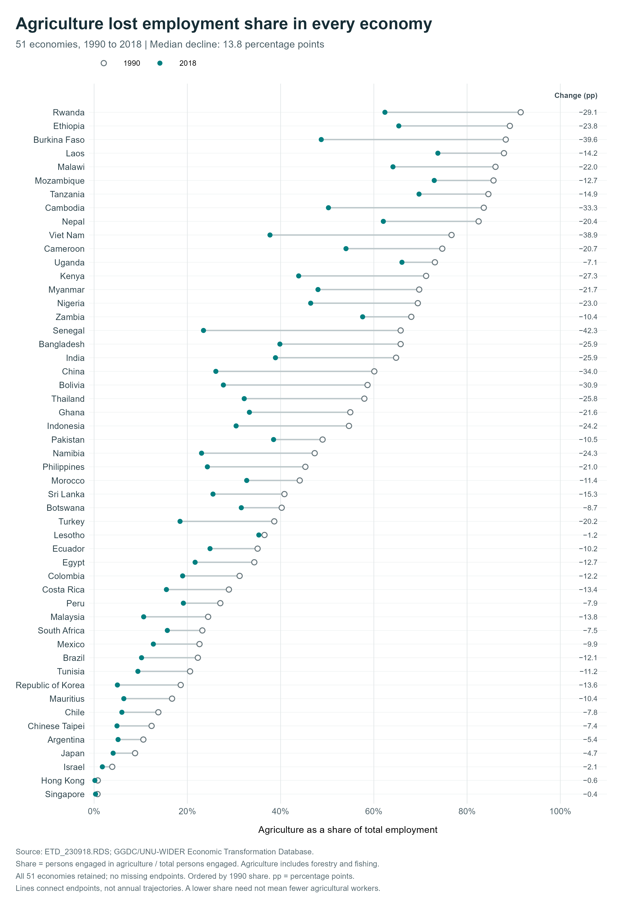
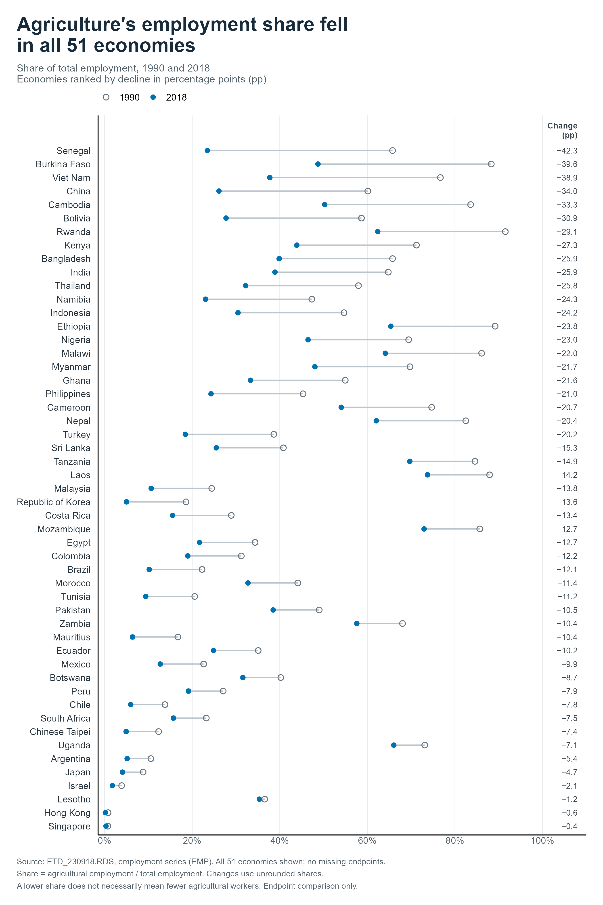

# A small guided-versus-unguided comparison

## Prompt

> Examine the data in this folder and create one useful, publication-ready
> graph in R with ggplot2. Choose the question, measure, and chart form you
> think communicate the most interesting feature of the data. Keep the result
> clear, honest, and understandable on its own. Save both the PNG and the R
> script.

The guided run additionally received:

> Follow the plotting guidance in `README.md`.

## Without the guide

## With the guide

